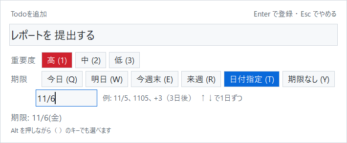
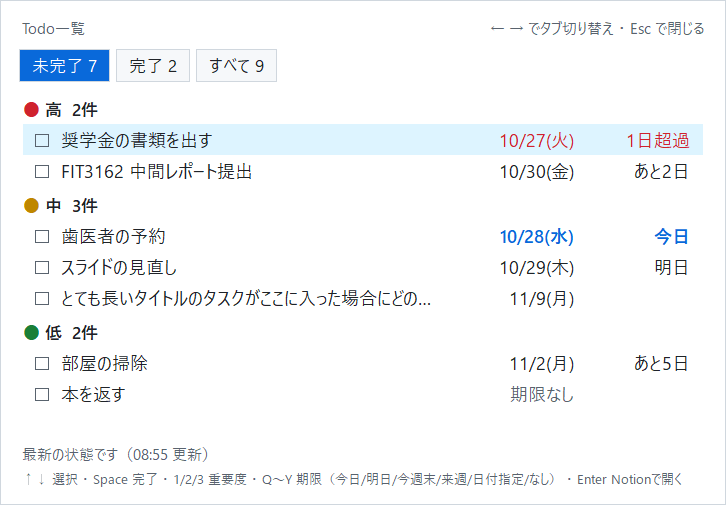

# todo-sync

ショートカットキー1つでTodoを登録し、Notion のデータベースと Google ToDoリスト（Googleカレンダーの期日欄）を双方向に同期する Windows 用の常駐アプリです。

- **登録（`Ctrl + Alt + T`）**: テキストを選択して押すと、そのテキストをタイトルにして登録画面が開きます。何も選択せずに押すと空の入力欄が開きます。重要度（高・中・低）と期限を選んで Enter で登録します。
- **一覧（`Ctrl + Alt + L`）**: 残っているタスクを重要度ごとに表示します。その場で完了・重要度・期限を変更できます。
- **同期**: Notion で変更しても、Googleカレンダー（スマホ含む）で完了・追加・編集しても、もう片方に反映されます。

## 登録画面



| 操作 | キー |
|---|---|
| 重要度（高・中・低） | `Alt + 1 / 2 / 3`（初期値は中） |
| 期限（今日・明日・今週末・来週・日付指定・期限なし） | `Alt + Q / W / E / R / T / Y`（初期値は今日） |
| 日付指定 | `11/5`、`1105`、`+3`（3日後）。`↑ ↓` で1日ずつ。全角でも可 |
| 登録 / やめる | `Enter` / `Esc` |

- 今週末 = 次の日曜日（今日が日曜ならその日）、来週 = 次の月曜日
- 登録日時と、呼び出したときのウィンドウ名（取得元）は自動で保存します
- 他のウィンドウをクリックして閉じた場合は、次に開いたときに入力途中の内容を戻します

## 一覧画面



| 操作 | キー |
|---|---|
| 選択 | `↑ ↓`（クリックでも可） |
| 完了 / 未完了に戻す | `Space`（チェックボックスのクリック、ダブルクリックでも可） |
| 重要度を変える | `1 / 2 / 3` |
| 期限を変える | `Q / W / E / R / T / Y`（登録画面と同じ。`Alt` 付きでも可） |
| タブ（未完了・完了・すべて） | `← →` / `Tab` |
| Notionでページを開く | `Enter` |
| 閉じる | `Esc` |

持ち越し中のもの（「2日持ち越し」など）は赤、今日が期限のものは青で表示します。手元の内容をすぐに表示し、裏で Notion から最新の状態を取り直します。

## 同期のしくみ

```
[PC] Ctrl+Alt+T / Ctrl+Alt+L ─┐
[スマホ] Notionアプリ ─────────┤
                              ▼
                   Notion データベース（データの正本）
                              ▲▼ 3分おき ＋ 登録・変更の直後に同期
                   Google ToDoリスト「Todo」 ─→ Googleカレンダーの期日欄に表示
                              ▲
[スマホ] Googleカレンダー / ToDoリスト
```

- **項目ごとの3者比較**: タイトル・重要度・期限・完了のそれぞれについて、前回同期したときの値（Notion の「同期スナップショット」）と比べ、変わった側の値をもう片方へ反映します。両方で変わっていたら更新時刻が新しい方を採用します。
- **Google側の重要度**: タイトル先頭の印（🔴🟡🟢）で表します。スマホから `🔴 〇〇` と入力すれば「高」として取り込みます（印がなければ「中」）。
- **削除**: Google で削除したら Notion ではゴミ箱へ（30日間は戻せる）、Notion でゴミ箱に入れたら Google からも削除します。
- **完了したタスク**: Googleカレンダーでは取り消し線つきで期日の欄に残ります。
- **期限を過ぎたタスクの持ち越し**: 期限までに完了しなかったタスクは、日付が変わると期限を今日に動かし、カレンダーでは今日の欄に表示します。最初の期限は Notion の「元の期限」と Google のメモ欄（`持ち越し中（元の期限: 10/26(月)）`）に残します。期限を先の日付に変え直すか期限なしにすると、持ち越しは終わります。完了したタスクと期限なしのタスクは動かしません。

## 工夫した点

- **データの入口を1つに**: 登録画面・一覧画面は Notion に書き込むだけで、Google への反映は常に同期処理が行います。経路が1本なので、二重登録や反映漏れが起きにくくなっています。
- **同期の状態を Notion に持たせる**: 前回同期した値と Google 側のIDを Notion のプロパティに保存しているため、同期処理自体は状態を持ちません。将来クラウドで定期実行する場合も、動かす場所を変えるだけで済みます。
- **途中で失敗しても壊れない順序**: Google を更新してから同期記録を書くので、通信が途中で切れても次回やり直せます。Google に追加した直後に Notion への書き込みが失敗した場合も、メモ欄のリンクから対応を見つけてつなぎ直し、重複を作りません。
- **大量削除の防止**: 1回の同期で5件以上かつ全体の半数以上を削除しようとしたら、設定ミスを疑って同期を止めます。
- **オフラインでも登録できる**: Notion に接続できないときは手元に保留し、次の同期で自動的に再送します。
- **作業を止めない画面**: 通信はすべて別スレッドで行い、登録画面は Enter ですぐに閉じます（結果は通知で表示）。一覧画面は変更を先に画面へ反映し、変更前に取得した古い一覧で上書きしないよう、変更のたびに番号を振っています。
- **選択テキストの取得**: Ctrl+C を送ってコピーし、もとのクリップボードの文字列は書き戻します。Ctrl+C で処理が止まるコンソール画面では送りません。
- **ログインの期限切れ**: Google のログインが切れても裏でブラウザを勝手に開かず、通知で知らせて、メニューから再ログインできるようにしています。

## セットアップ

### 1. Notion

1. Notion の開発者ツールで「コネクト」（APIトークン）を作成し、シークレット（`ntn_...`）を控えます。
2. データベースを作り、プロパティを次の名前・種類で作成します（名前はコードと完全一致）。

   | プロパティ名 | 種類 |
   |---|---|
   | タイトル | タイトル |
   | 重要度 | セレクト（`高`・`中`・`低`） |
   | 期限 | 日付 |
   | 完了 | チェックボックス |
   | 完了日時 | 日付 |
   | 登録日時 | 作成日時 |
   | 取得元 | テキスト |
   | GTask ID | テキスト |
   | 同期スナップショット | テキスト |
   | 元の期限 | 日付 |

3. データベースの「•••」→「コネクト」から、作成したコネクトを追加します。

   ※ 日付・テキストなどのプロパティが足りない場合は、`check_setup.py` が自動で追加します。

### 2. Google

1. Google Cloud でプロジェクトを作り、**Google Tasks API** を有効にします。
2. OAuth 同意画面（Google Auth Platform）を「外部」で作成し、「対象」→「テストユーザー」に自分のアドレスを追加します。
3. 「クライアント」で **デスクトップアプリ** のクライアントを作成し、JSON をダウンロードして `credentials.json` という名前でこのフォルダに置きます。

> アプリが「テスト中」の間は、Google の仕様で7日ごとに再ログインが必要です（通知が出たら、アイコンのメニューの「Googleに再ログイン」）。本番環境に公開するには、ホームページとプライバシーポリシーのURLが必要です。

### 3. インストールと確認

```
python -m venv .venv
.venv\Scripts\pip install -r requirements.txt
copy .env.example .env      # NOTION_TOKEN と NOTION_DATABASE_ID を記入
.venv\Scripts\python check_setup.py
```

`check_setup.py` は Notion のプロパティを確認し、初回は Google のログイン画面を開きます。すべて ✓ になれば準備完了です。

### 4. 起動

```
.venv\Scripts\pythonw.exe app.py
```

通知領域（画面右下）に緑の「T」のアイコンが出ます。アイコンを右クリックすると、一覧・今すぐ同期・Googleに再ログイン・**PCの起動時に自動で起動**・終了ができます。

同期だけをコマンドで実行することもできます。

```
.venv\Scripts\python sync.py            # 1回同期する
.venv\Scripts\python sync.py --dry-run  # 何をするかを表示するだけ
```

## iPhone のロック画面に今日のTodoを表示する（任意）

無料アプリ [Scriptable](https://apps.apple.com/app/scriptable/id1405459188) のウィジェットとして、今日が期限（持ち越し分を含む）で未完了のタスクを重要度の高い順に表示します（`ios/today-widget.js`）。ウィジェットをタップすると今日のTodoのチェックリストが開き、タップで完了にできます（もう一度タップで元に戻す）。完了は Notion に保存され、PC の todo-sync が次の同期で Google カレンダーにも反映します。

```
┌──────────────────┐
│ 今日のTodo 3件     │   時計の下（長方形）: 件数と上位2件
│ 高 レポート提出     │   時計の上（1行）  : Todo 3件 ▸ レポート提出
│ 中 歯医者の予約 他1 │   丸形             : 件数
└──────────────────┘
```

1. **スマホ用のトークンを作る**: Notion の開発者ツールで新しいコネクト（APIトークン）を作り、機能は「コンテンツを読み取る」と「コンテンツを更新」だけにします（「挿入」などは外す）。Todo データベースの「•••」→「コネクト」から追加します。PC 用とは別のトークンにしておけば、スマホをなくしたときにこのトークンだけを無効にできます。
2. **スクリプトを入れる**: iPhone に Scriptable を入れ、右上の「＋」で新しいスクリプトを作り、`ios/today-widget.js` の中身を貼り付けます。名前は `Todo` などにします。
3. **設定する**: スクリプトを1回実行し、トークンとデータベースの ID（URL を貼っても可）を入力します。キーチェーンに保存され、スクリプトには書き込まれません。アプリ内で実行すると、チェックリスト・ウィジェットのプレビュー・設定し直しを選べます。
4. **ロック画面に置く**: ロック画面を長押し →「カスタマイズ」→「ロック画面」→ ウィジェットの欄から Scriptable を追加し、追加したウィジェットをタップして Script に `Todo` を選びます。ホーム画面のウィジェット（小・中）にも使えます。

- ロック画面は白黒表示なので、重要度は「高・中・低」の文字で表します（ホーム画面では色付きの●）。
- 表示の更新タイミングは iOS が決めます（目安は十数分〜数十分ごと）。チェックリストで完了にしても、ウィジェットから消えるのは次の更新のときです。
- ウィジェットの上で直接チェックを付けることはできません（Scriptable のウィジェットは表示専用のため）。タップでチェックリストを開いて操作します。
- PC が切れている間に完了にした分は、次に PC の todo-sync が同期したときに Google カレンダーへ反映されます。

## ファイル構成

| ファイル | 役割 |
|---|---|
| `app.py` | 常駐アプリの本体（ホットキー・通知領域のアイコン・画面の切り替え） |
| `add_popup.py` / `list_popup.py` | 登録画面 / 一覧画面 |
| `background.py` | 登録・変更・定期同期を裏で行う |
| `sync.py` | Notion と Google ToDoリストの同期 |
| `notion_api.py` / `gtasks_api.py` | 各APIとのやり取り |
| `google_auth.py` | Google へのログイン（`token.json` に保存） |
| `hotkey.py` | グローバルホットキーと選択テキストの取得（Windows API） |
| `due.py` | 期限の選択肢と日付入力の読み取り |
| `pending.py` | Notion に送れなかった登録の保留と再送 |
| `startup.py` | PCの起動時に自動で起動する設定 |
| `check_setup.py` | Notion・Google の準備ができているかの確認 |
| `config.py` | 設定値（`.env`）とプロパティ名 |
| `ios/today-widget.js` | iPhone のロック画面・ホーム画面に今日のTodoを表示し、チェックリストで完了にできる Scriptable 用スクリプト |

`.env`・`credentials.json`・`token.json` は `.gitignore` で GitHub に上がらないようにしています。動作の記録は `todo-sync.log` に残ります。
